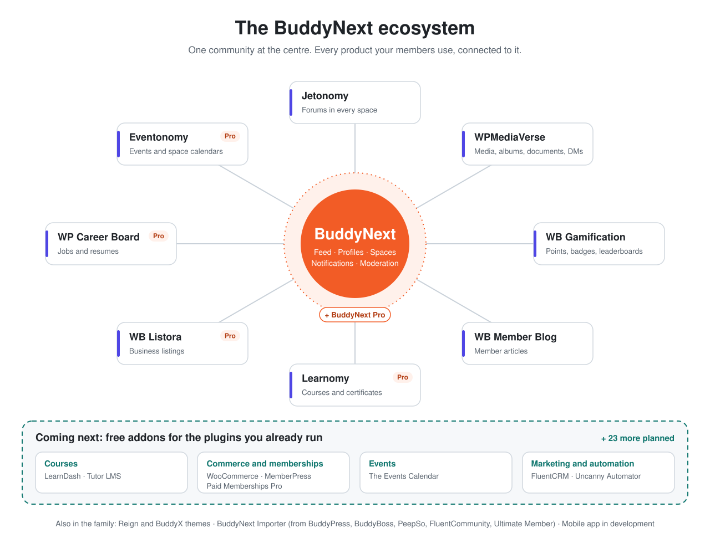

# BuddyNext

**The Community OS for WordPress.** A real-time feed, Spaces, and profiles your members actually want to open, on any device.

BuddyNext is a self-hosted community engine built by [Wbcom Designs](https://wbcomdesigns.com). Your community, your data, your database, with a full REST API for web and mobile clients.

---

## What BuddyNext Is

- **Real-time activity feed, Spaces, and member profiles** that feel like a modern social app, not a legacy forum.
- **A full REST API** across Free and Pro, documented in OpenAPI, so you can build your own clients on your own data.
- **Mobile-friendly and installable** as a web app on any phone. A native app is in development.
- **Self-hosted:** it runs on your WordPress, stores data in its own tables, and stays fast as the community grows.

An alternative to hosted community platforms, built for teams that want to own their community outright.

---

## The Ecosystem

<picture>
  <source media="(prefers-color-scheme: dark)" srcset="images/buddynext-ecosystem-dark.svg">
  
</picture>

Install any of these next to BuddyNext and it connects on its own. No extra plugin needed.

| Product | What it adds to your community | Links |
|---|---|---|
| **BuddyNext** | Feed, profiles, spaces, messaging, notifications, moderation | [Site](https://buddynext.com) · [Docs](https://buddynext.com/docs/) · [Videos](https://buddynext.com/videos/) |
| **BuddyNext Pro** | Paid memberships, email broadcasts and drips, analytics, realtime, push, AI | [Pricing](https://buddynext.com/pricing/) · [Docs](https://buddynext.com/docs/pro/) |
| **WPMediaVerse** | Photos, videos, albums, documents and direct messages | [Site](https://wpmediaverse.com) · [Docs](https://wpmediaverse.com/docs/) · [Videos](https://wpmediaverse.com/videos/) |
| **Jetonomy** | Forums and discussions inside every space | [Site](https://jetonomy.org) · [Docs](https://jetonomy.org/docs/) · [Videos](https://jetonomy.org/videos/) |
| **WB Gamification** | Points, badges and leaderboards | [Plugin](https://wordpress.org/plugins/wb-gamification/) · [Docs](https://docs.wbcomdesigns.com/products/wb-gamification/) |
| **WB Member Blog** | Member articles on every profile | [Plugin](https://wordpress.org/plugins/buddypress-member-blog/) |
| **Learnomy** (Pro) | Courses, certificates and course communities | [Site](https://learnomy.app) · [Docs](https://learnomy.app/docs/) · [Videos](https://learnomy.app/videos/) |
| **Eventonomy** (Pro) | Events, RSVPs and space calendars | [Site](https://eventonomy.org) · [Docs](https://eventonomy.org/docs/) · [Videos](https://eventonomy.org/videos/) |
| **WB Listora** (Pro) | Business listings and directories | [Site](https://listora.org) · [Docs](https://listora.org/docs/) · [Videos](https://listora.org/videos/) |
| **WP Career Board** (Pro) | Jobs and resumes | [Site](https://wpcareerboard.com) · [Docs](https://docs.wbcomdesigns.com/products/wp-career-board/) · [Videos](https://wpcareerboard.com/videos/) |

Moving from BuddyPress, BuddyBoss, PeepSo, FluentCommunity or Ultimate Member? [BuddyNext Importer](https://github.com/buddynext/buddynext-importer) brings your members and content with you. Themes: [BuddyX](https://github.com/buddynext/buddyx) and Reign.

---

## Coming Next: Free Addons

Already run LearnDash, WooCommerce or The Events Calendar? A free addon per plugin will connect it to your community: achievements in the feed, richer profiles, and spaces that fill themselves when someone enrolls or buys. Install only the ones you need.

First up: LearnDash, Tutor LMS, WooCommerce, MemberPress, Paid Memberships Pro, The Events Calendar, FluentCRM and Uncanny Automator.

- **See the plan:** [roadmap board](https://github.com/orgs/buddynext/projects/1) and [the announcement](https://github.com/buddynext/buddynext/discussions/208)
- **Tell us what you need:** [Ideas in Discussions](https://github.com/buddynext/buddynext/discussions)

---

## For Developers

- **Docs:** [buddynext.com/docs](https://buddynext.com/docs/)
- **Interactive API reference:** [buddynext.com/developers/api](https://buddynext.com/developers/api/)
- **Developer hub:** [buddynext.com/developers](https://buddynext.com/developers/)
- **Build an addon:** the addon framework, developer guide and starter addon are in progress. Every addon is open source in this org.

---

## Built by Wbcom Designs

BuddyNext is part of the [Wbcom Designs](https://wbcomdesigns.com) product line, a full-stack product engineering studio building WordPress, community, AI, and headless products since 2013.

- **Site:** [buddynext.com](https://buddynext.com)
- **Studio:** [wbcomdesigns.com](https://wbcomdesigns.com)
